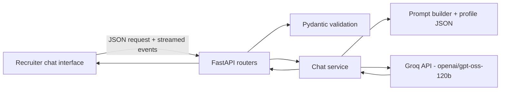

# Akhil Mukesh Bot — My AI Representative

A recruiter-facing chatbot powered by FastAPI and Groq. It answers from a
directly loaded profile JSON file; it does not use RAG, embeddings, or a vector
database. The Groq API key is only used by the backend.
Chat responses stream as they are generated, use structured answer, profile
evidence, missing-information, and follow-up sections, and retain the recent
conversation history for follow-up questions.

## Run the app

Requires Python 3.9 or newer. The recruiter interface and API are served together
by FastAPI.

```powershell
python -m venv .venv
.\.venv\Scripts\Activate.ps1
python -m pip install -r api\requirements.txt
Copy-Item .env.example .env
```

Add your Groq API key to the `GROQ_API_KEY` setting in the root `.env` file.
Do not put API keys in source files or share them in chat. Then run the API
from the repository root:

```powershell
python -m uvicorn app.main:app --app-dir api --reload --port 8000
```

Open the recruiter interface at <http://localhost:8000>. Check API health at
<http://localhost:8000/api/health>; interactive API docs are at
<http://localhost:8000/docs>.

### Add your profile

Edit [api/app/data/profile.json](api/app/data/profile.json) to update your
public professional details. The profile is populated from the resume currently
in the repository; verify that each fact is accurate and that you are
comfortable sharing it publicly. Do not add private information. The assistant
receives only populated profile fields.
If a fact is absent, it is instructed to say it does not have that information
instead of inventing an answer.

Add your resume PDF to `api/app/data/`. The recruiter profile will show a
download button when `resume.pdf` is present, or when exactly one other PDF
(such as `Akhil_Mukesh_Resume.pdf`) is present in the folder. Only add a resume
you are comfortable making publicly downloadable.

Optionally, add a PDF cover letter to the same folder with `cover_letter` in
its filename, such as `Akhil_Mukesh_Cover_Letter.pdf`. A separate download
button will appear when exactly one matching cover letter is present.

Fill in `profile.json` with your public name, title, bio, contact email, phone,
skills, and links. Add experience entries with a role/title, company, dates,
and description, for example:

```json
"experience": [
  {
    "title": "Software Engineer",
    "company": "Example Company",
    "dates": "2022–2025",
    "description": "Built and maintained customer-facing services."
  }
]
```

You can also update public education, certifications, achievements, and projects
in their respective arrays. These details are available to the assistant for
recruiter questions but are not displayed as separate profile sections. Restart
the backend after editing the profile JSON so the assistant loads your updated
details.

### Configuration

See [.env.example](.env.example). The default model is `openai/gpt-oss-120b`.
`CORS_ORIGINS` is a comma-separated list of allowed frontend origins. Chat
requests are limited per client IP in each API process; this in-memory limiter
is suitable for local/single-process use, and should be replaced with a shared
limiter before running multiple workers or instances.

### Run tests

From the repository root:

```powershell
python -m pytest api\tests
```

Tests mock Groq and do not require a key or network access.

## Architecture



## Project status

- [x] Phase 1: FastAPI backend, direct profile context, Groq integration, and tests
- [x] Phase 2: Recruiter-facing chat interface and job-fit assessment
- [ ] Phase 3: Docker, deployment, and final documentation
